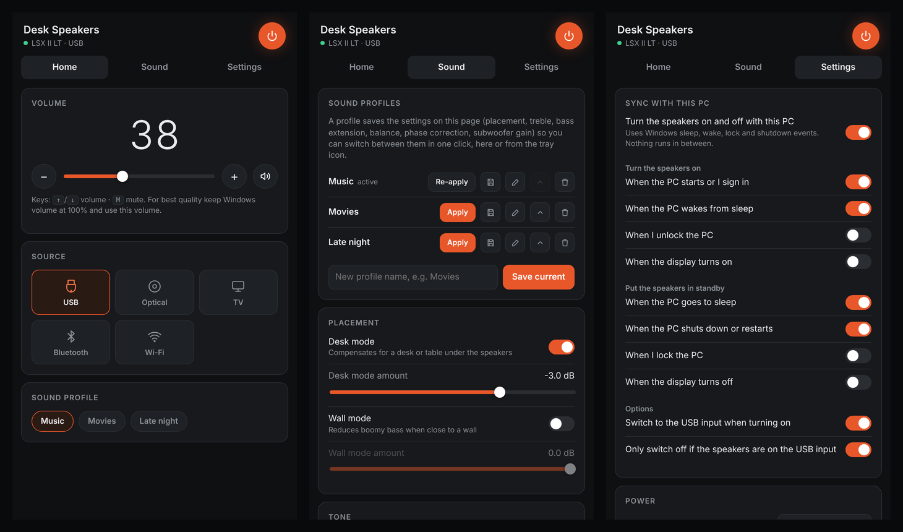
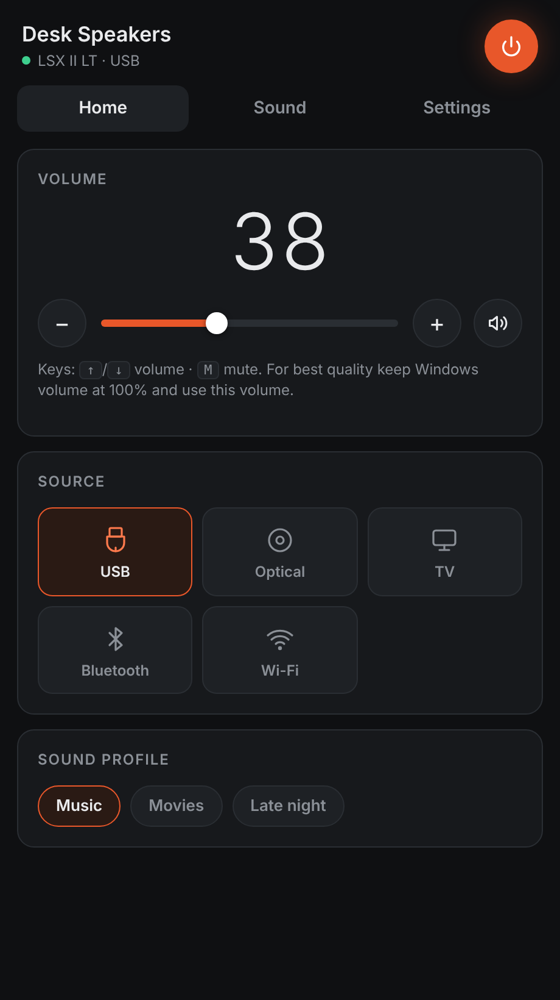

# KEF Control for Windows

A small, free desktop app for controlling **KEF wireless speakers** from your PC, so you don't need to reach for your phone and the KEF Connect app. It was made for the **LSX II LT** used as PC speakers. It should also work with the other speakers on KEF's current wireless platform (LSX II, LS50 Wireless II, LS60 Wireless, XIO, LS LUXE).



> Unofficial. Not affiliated with or endorsed by KEF.

## Features

- **Everyday controls:** power, volume (slider, +/−, mouse wheel, ↑/↓ keys), mute, and input selection (USB, Optical, TV, Bluetooth, Wi-Fi).
- **All of the speaker's sound settings:** desk mode, wall mode, treble trim, bass extension, balance, phase correction, speaker polarity, and the subwoofer options (model preset, gain, low-pass, polarity, high-pass). There's also a reset to KEF defaults.
- **Sound profiles:** save your settings as named profiles, such as *Music*, *Movies* or *Late night*, and switch between them in one click from the app or the tray icon.
- **Sync with your PC:** the speakers turn on when the PC starts or wakes, and go to standby when it sleeps or shuts down. Lock, unlock and display on/off triggers are optional. By default the app never switches the speakers off while you're playing from something else, such as Bluetooth from your phone.
- **Auto-reconnect:** if your router gives the speakers a new IP address, the app finds them again on the network by their MAC address.
- **Speaker settings:** auto-standby time, wake-up source, auto-switch to TV, startup tone, maximum volume, volume step, wake-up volume, front LED and standby LED, USB charging, which side is the primary speaker, speaker name, and restart.
- **Tray icon:** lives in the taskbar's hidden-icons area (the **^** by the clock), with quick controls on right-click. It uses about 40 MB of RAM and no CPU while idle, and never polls the speakers in the background.
- **Normal Windows install:** a standard installer with Start menu shortcuts, an optional Start with Windows setting, and an uninstaller in *Settings → Apps*. No admin rights needed, and no Python install required.

## Requirements

- Windows 10 or 11 (64-bit) with Microsoft Edge (built in) or Google Chrome.
- **Your speakers must be connected to your home network (Wi-Fi).** USB carries the audio only; the speakers are controlled over the network, the same way KEF Connect does it. If you've never connected them to Wi-Fi, do that once in KEF Connect on any phone or tablet. After that you won't need the phone again. Internet access isn't needed, only your local network.

## Install

1. Download **`KEFControl-Setup-x.y.z.exe`** from the [latest release](../../releases/latest).
2. Run it. Windows may show **"Windows protected your PC"** because the installer isn't code-signed. Click **More info → Run anyway**.
3. Choose your options:
   - **Desktop shortcut** (on by default)
   - **Start with Windows (tray icon)** (on by default)
4. Click **Install**, then **Finish** to open KEF Control.

It installs per user to `%LOCALAPPDATA%\Programs\KEF Control`, with no admin prompt. Running a newer installer later updates the app in place and keeps your settings.

## First run

1. Open **KEF Control** from the Start menu or desktop.
2. Click **Find speakers on my network**, or type the speaker's IP address and click **Connect**.
   - The IP is shown in KEF Connect (speaker → Settings → About) or in your router's device list.
3. That's it. The app remembers your speakers, including if their IP address changes later.

## Using the app

### Home


- **Power button** (top right): turns the speakers on or puts them in standby.
- **Volume:** drag the slider, use **−/+**, scroll the mouse wheel over the card, or press **↑/↓**. **M** toggles mute.
  For the cleanest sound over USB, leave the Windows volume at 100% and use this volume control.
- **Source:** click an input to switch to it.
- **Sound profile:** one-click buttons for your saved profiles (shown once you've created one).

### Sound and profiles


All the speaker's own sound settings, applied instantly as you change them.

**Creating a profile**
1. Set placement, treble, bass extension and so on the way you like.
2. Type a name, such as *Movies*, in **New profile name** and click **Save current**.

**Managing profiles**
| Button | What it does |
|---|---|
| **Apply** | Switches the speakers to that profile's settings |
| 💾 | Replaces the profile with the current settings |
| ✏️ | Renames it |
| ^ | Moves it up the list. The order is used on Home and in the tray menu |
| 🗑 | Deletes it |

If you change a setting after applying a profile, it's marked **"active · changed"** so you know the current sound differs from what's saved. A profile stores: desk mode and amount, wall mode and amount, treble, bass extension, balance, phase correction and subwoofer gain.

### Settings and PC sync


**Sync with this PC** turns the speakers on and off together with your computer:

| Turn the speakers on… | Default |
|---|---|
| When the PC starts or I sign in | On |
| When the PC wakes from sleep | On |
| When I unlock the PC | Off |
| When the display turns on | Off |

| Put the speakers in standby… | Default |
|---|---|
| When the PC goes to sleep | On |
| When the PC shuts down or restarts | On |
| When I lock the PC | Off |
| When the display turns off | Off |

| Options | Default |
|---|---|
| Switch to the USB input when turning on | On |
| Only switch off if the speakers are on the USB input | On |

This needs the tray icon to be running, which it is when *Start with Windows* is on. The app listens for Windows' own power events, so it does nothing between events. The last few actions are listed under **Recent**, which helps if you're unsure what happened.

The rest of the Settings page has the speaker's own settings (standby, volume limits, LEDs and so on) and speaker info.

### Tray icon
Click the **^** next to the clock to find the KEF icon. You can drag it onto the taskbar to keep it always visible.

- **Left-click:** opens the window. Closing the window leaves the icon running.
- **Right-click:** status, standby/on, mute, volume up/down, **Source**, **Sound profile**, **Start with Windows**, **Quit**.

## Uninstall

- **Settings → Apps → Installed apps → KEF Control → Uninstall**, or
- Run `Uninstall.exe` in `%LOCALAPPDATA%\Programs\KEF Control`.

The uninstaller closes the app and removes its files, shortcuts and Start with Windows entry. Your saved speaker address and profiles stay in `%APPDATA%\KEFControl` in case you reinstall. Delete that folder to remove them too.

## Troubleshooting

| Problem | Try this |
|---|---|
| "Can't reach the speaker" | Make sure the speakers are on and connected to Wi-Fi, and that the PC is on the same network. Wait a minute after an IP change for auto-reconnect, or click **Change speaker**. |
| "Find speakers" finds nothing | Some routers block discovery. Type the IP address instead. |
| Speakers didn't turn on after waking the PC | Wi-Fi can take a few seconds to come back; the app keeps retrying for about a minute. Check **Settings → Sync with this PC → Recent**. |
| Speakers didn't go to standby | With *Only switch off if… USB* on, nothing happens when they're playing from another input. |
| "Port 47801 is in use" | Another program is using the port KEF Control needs. Close it, or restart the PC. |
| Anything else | Restart the app from the tray menu (**Quit**, then reopen it), or reinstall over the top. |

## Privacy and security

- Everything stays on your local network. The app talks only to your speakers and doesn't use the internet or send any data out.
- The window is a small local web page served at `http://127.0.0.1:47801`, which only your own PC can reach. Requests from other websites are rejected.

## Why not control the speakers over USB?

The LSX II LT's USB port is a standard USB sound card. Apart from the sound card, it exposes only a tiny undocumented HID channel, which offers no way to read the speaker's settings. KEF's own app controls everything over the network, and so does this one.

## Building from source

**Run from source** (Python 3.12+, any OS for the window; tray and PC sync are Windows-only):
```bash
pip install -r src/requirements.txt
python src/kef_control.py            # tray icon + window
python src/kef_control.py --no-tray  # window only
python src/kef_control.py --debug    # with log output
```

**Build the Windows installer** (on Linux, no Windows needed):
```bash
sudo apt install nsis gcc-mingw-w64-x86-64 binutils-mingw-w64-x86-64 python3-pip unzip curl
cd installer && ./build.sh
```
This bundles the official embeddable Python and the dependencies' Windows wheels, compiles the small native launcher (`launcher.c`), and builds `KEFControl-Setup-<version>.exe` with NSIS.

**Testing without speakers:** `tools/mock_speaker.py` imitates an LSX II LT's local API on `127.0.0.1:80`. Run it, then connect the app to `127.0.0.1`.

### Project layout
```
src/kef_control.py   app core: local web server, speaker manager, profiles, reconnect
src/tray.py          system-tray icon and menu, Start with Windows
src/powersync.py     Windows power and session events → speaker on/standby
src/ui.html          the app window (plain HTML/CSS/JS)
installer/           launcher, NSIS script, build script
tools/               mock speaker for development
```

## Credits and licenses

- KEF Control is released under the [MIT License](LICENSE).
- Speaker communication uses [pykefcontrol](https://github.com/N0ciple/pykefcontrol) (MIT).
- The installer bundles the [Python](https://www.python.org/) embeddable runtime (PSF License), [pystray](https://github.com/moses-palmer/pystray) (LGPL-3.0), [Pillow](https://python-pillow.org/) (MIT-CMU), [python-zeroconf](https://github.com/python-zeroconf/python-zeroconf) (LGPL-2.1), aiohttp, urllib3 and their dependencies. These are unmodified, and each keeps its own license.
- KEF, LSX and related names are trademarks of KEF / GP Acoustics. This project is not affiliated with KEF.
