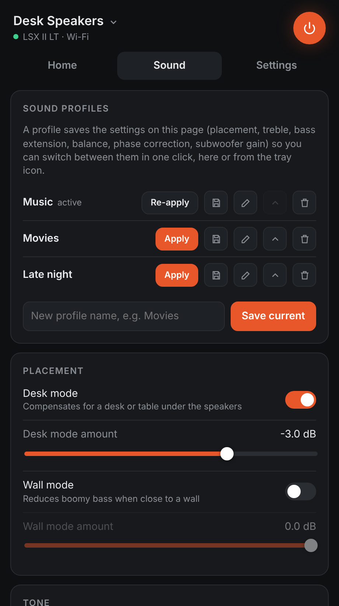
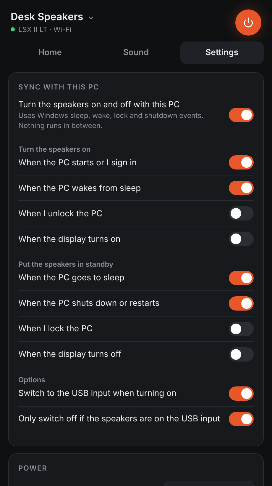

# KEF Control for Windows: a free KEF Connect app for PC

**Control KEF LSX II, LSX II LT, LS50 Wireless II and LS60 speakers from your Windows PC.** KEF Control is a free, open-source desktop alternative to the KEF Connect app. You get volume, inputs, every sound setting, sound profiles, now playing, and speakers that turn on and off with your computer, all from the Windows tray.

**[⬇ Download for Windows](../../releases/latest)** · **[Website](https://jung1021.github.io/kef-control-app/)** · [Report a problem](../../issues/new?template=bug_report.yml)


> Unofficial. Not affiliated with or endorsed by KEF.

## Why KEF Control?

KEF doesn't make a Windows version of KEF Connect, so if you use your KEF speakers as PC speakers you have to pick up your phone for every setting. KEF Control puts it all on your PC:

| | KEF Control (Windows) | KEF Connect (phone) |
|---|:---:|:---:|
| Runs on Windows | ✅ | – |
| Volume, inputs, sound settings | ✅ | ✅ |
| Tray icon with quick controls | ✅ | – |
| Turn the speakers on and off with your PC | ✅ | – |
| No account needed | ✅ | – |
| First-time Wi-Fi setup, firmware updates, music streaming | – | ✅ |

## Features

- **Everyday controls:** power, volume (slider, +/−, mouse wheel, ↑/↓ keys), mute and inputs (USB, Optical, TV, Bluetooth, Wi-Fi).
- **All the speaker's sound settings:** desk mode, wall mode, treble trim, bass extension, balance, phase correction, speaker polarity, and the subwoofer options (model preset, gain, low-pass, polarity, high-pass). There's also a reset to KEF defaults.
- **Sound profiles:** save named setups like *Music*, *Movies* or *Late night* and switch with one click, in the app or from the tray.
- **Sync with your PC:** the speakers turn on when the PC starts or wakes, and go to standby when it sleeps or shuts down. Lock, unlock and display triggers are optional. By default the app never switches the speakers off while you're playing from something else, such as Bluetooth from your phone.
- **Now playing:** track, artist, album art and play/pause/skip when you stream to the speakers over Wi-Fi or Bluetooth.
- **Multiple speakers:** save several pairs, for example desk and living room, and switch from the title bar or the tray.
- **Auto-reconnect:** if the router gives the speakers a new IP address, the app finds them again by their MAC address.
- **Speaker settings:** auto-standby, wake-up source, auto-switch to TV, startup tone, maximum volume, volume step, wake-up volume, LEDs, USB charging, primary speaker side, speaker name and restart.
- **Light and dark themes** that follow Windows.
- **Tiny footprint:** the tray icon uses about 40 MB of RAM and no CPU while idle, and never polls the speakers in the background.
- **Normal Windows install:** per-user installer, Start menu shortcut, optional Start with Windows, and an uninstaller in *Settings → Apps*. No admin rights, no Python install, no account.
- **Built-in update check** and **Copy diagnostics** for quick bug reports.

**Supported speakers** (KEF's W2 platform): LSX II, LSX II LT, LS50 Wireless II, LS60 Wireless, XIO, LS LUXE.
Not supported: the first-generation LSX and LS50 Wireless.

## Requirements

- Windows 10 or 11 (64-bit) with Microsoft Edge (built in) or Google Chrome.
- **The speakers must be connected to your home network (Wi-Fi).** USB carries the audio only; the speakers are controlled over the network, the same way KEF Connect does it. If you've never connected them, do that once in KEF Connect on any phone or tablet. After that you won't need the phone again. Internet access isn't needed.

## Install

1. Download **`KEFControl-Setup-x.y.z.exe`** from the [latest release](../../releases/latest).
2. Run it. Windows may show **"Windows protected your PC"** because the installer isn't code-signed. Click **More info → Run anyway**.
3. Choose your options:
   - **Desktop shortcut** (on by default)
   - **Start with Windows (tray icon)** (on by default)
4. Click **Install**, then **Finish** to open KEF Control.

It installs per user to `%LOCALAPPDATA%\Programs\KEF Control`, with no admin prompt. Running a newer installer updates the app in place and keeps your settings.

## First run

1. Open **KEF Control** from the Start menu or desktop.
2. Click **Find speakers on my network**, or type the speaker's IP address and click **Connect**.
   - The IP is shown in KEF Connect (speaker → Settings → About) or in your router's device list.
3. To add another pair later, click the speaker name at the top and choose **Add another speaker**.

## Using the app

### Home


- **Speaker name** (top left): switch between saved speakers, or add another.
- **Power button** (top right): turns the speakers on or puts them in standby.
- **Now playing:** appears when you stream over Wi-Fi or Bluetooth, with play/pause and skip.
- **Volume:** drag the slider, use **−/+**, scroll the mouse wheel over the card, or press **↑/↓**. **M** toggles mute.
  For the cleanest sound over USB, leave the Windows volume at 100% and use this volume control.
- **Source:** click an input to switch to it.
- **Sound profile:** one-click buttons for your saved profiles.

### Sound and profiles


All the speaker's own sound settings, applied instantly.

**Create a profile:** set things up the way you like, type a name such as *Movies* in **New profile name**, then click **Save current**.

| Button | What it does |
|---|---|
| **Apply** | Switches the speakers to that profile |
| 💾 | Replaces the profile with the current settings |
| ✏️ | Renames it |
| ^ | Moves it up the list. The order is used on Home and in the tray menu |
| 🗑 | Deletes it |

If you change a setting after applying a profile, it's marked **"active · changed"**. A profile stores: desk mode and amount, wall mode and amount, treble, bass extension, balance, phase correction and subwoofer gain.

### Settings and PC sync


**Sync with this PC** turns the speakers on and off together with your computer:

| Turn the speakers on… | Default | | Put them in standby… | Default |
|---|---|---|---|---|
| When the PC starts or I sign in | On | | When the PC goes to sleep | On |
| When the PC wakes from sleep | On | | When the PC shuts down or restarts | On |
| When I unlock the PC | Off | | When I lock the PC | Off |
| When the display turns on | Off | | When the display turns off | Off |

The options **Switch to the USB input when turning on** and **Only switch off if the speakers are on the USB input** are both on by default. The tray icon must be running for this to work, which it is when *Start with Windows* is on. The last few actions are listed under **Recent**.

The **App** section has the update check, **Copy diagnostics** and **Report a problem**.

### Tray icon
Click the **^** next to the clock to find the KEF icon. You can drag it onto the taskbar to keep it always visible.

- **Left-click:** opens the window. Closing the window leaves the icon running.
- **Right-click:** status, standby/on, mute, volume, **Source**, **Play / Pause** and **Next track** while streaming, **Sound profile**, **Speakers**, **Start with Windows**, **Quit**.

## Uninstall

- **Settings → Apps → Installed apps → KEF Control → Uninstall**, or
- run `Uninstall.exe` in `%LOCALAPPDATA%\Programs\KEF Control`.

The uninstaller closes the app and removes its files, shortcuts and Start with Windows entry. Your saved speakers and profiles stay in `%APPDATA%\KEFControl` in case you reinstall. Delete that folder to remove them too.

## FAQ

**Is there a KEF Connect app for Windows?**
KEF doesn't make one. KEF Control is a free, unofficial desktop app that does the PC-relevant parts of KEF Connect and adds PC-only features like the tray icon and power sync.

**Can I control the LSX II / LSX II LT over USB?**
No. Their USB-C port is a USB sound card for audio only, with no documented control channel. Settings go over Wi-Fi, just like KEF Connect.

**Why doesn't the speaker volume follow the Windows volume?**
They're separate. Keep Windows at 100% and use KEF Control, the tray menu or the remote for volume.

**Does it work with the first-generation LSX or LS50 Wireless?**
No. Those use an older protocol.

## Troubleshooting

| Problem | Try this |
|---|---|
| "Can't reach the speaker" | Make sure the speakers are on and connected to Wi-Fi, and the PC is on the same network. After an IP change, wait a minute for auto-reconnect. |
| "Find speakers" finds nothing | Some routers block discovery. Type the IP address instead. |
| Speakers didn't turn on after waking the PC | Wi-Fi can take a few seconds to come back; the app retries for about a minute. Check **Settings → Sync with this PC → Recent**. |
| Speakers didn't go to standby | With *Only switch off if… USB* on, nothing happens when they're playing from another input. |
| Stopped working after a KEF firmware update | Click **Settings → App → Copy diagnostics** and [open an issue](../../issues/new?template=bug_report.yml) with them. |
| "Port 47801 is in use" | Another program is using the port KEF Control needs. Close it, or restart the PC. |

## Privacy

- The app talks only to your speakers on your local network.
- If **Check for updates automatically** is on (the default), it asks GitHub once a day for the latest version number. Nothing about you or your speakers is sent. You can turn this off in **Settings → App**.
- No account, analytics or ads. The window is a small local page at `http://127.0.0.1:47801` that only your own PC can reach.

Full policy: [Privacy policy](https://jung1021.github.io/kef-control-app/privacy.html).

## Building from source

**Run from source** (Python 3.12+; the tray icon and PC sync are Windows-only):
```bash
pip install -r src/requirements.txt
python src/kef_control.py            # tray icon + window
python src/kef_control.py --no-tray  # window only
python src/kef_control.py --debug    # with log output
```

**Build the Windows installer** (on Linux, no Windows needed):
```bash
sudo apt install nsis gcc-mingw-w64-x86-64 binutils-mingw-w64-x86-64 python3-pip unzip curl
cd installer && ./build.sh
```
This bundles the official embeddable Python and the dependencies' Windows wheels, compiles the small native launcher (`launcher.c`), and builds `KEFControl-Setup-<version>.exe` with NSIS.

**Microsoft Store package:** see [`packaging/msix/build_msix.sh`](packaging/msix/build_msix.sh). **winget manifests:** [`packaging/winget`](packaging/winget).

**Testing without speakers:** `tools/mock_speaker.py` imitates an LSX II LT on `127.0.0.1:80`. Run it, then connect the app to `127.0.0.1`.

### Project layout
```
src/kef_control.py   app core: local web server, speakers, profiles, reconnect, updates
src/tray.py          system-tray icon and menu, Start with Windows
src/powersync.py     Windows power/session events → speaker on/standby
src/ui.html          the app window (plain HTML/CSS/JS)
installer/           launcher, NSIS script, build script
packaging/           Microsoft Store (MSIX) and winget packaging, launch notes
docs/                website (GitHub Pages) and screenshots
tools/               mock speaker for development
```

## Contributing

Bug reports, feature ideas and pull requests are welcome. Please include the output of **Copy diagnostics** with bug reports. If you own a KEF model other than the LSX II LT, a quick "works on my LS50 Wireless II / LS60 / XIO" issue is very helpful.

## Credits and licenses

- KEF Control is released under the [MIT License](LICENSE).
- Speaker communication uses [pykefcontrol](https://github.com/N0ciple/pykefcontrol) (MIT).
- The installer bundles the [Python](https://www.python.org/) embeddable runtime (PSF License), [pystray](https://github.com/moses-palmer/pystray) (LGPL-3.0), [Pillow](https://python-pillow.org/) (MIT-CMU), [python-zeroconf](https://github.com/python-zeroconf/python-zeroconf) (LGPL-2.1), aiohttp, urllib3 and their dependencies. These are unmodified, and each keeps its own license.
- KEF, LSX and related names are trademarks of KEF / GP Acoustics. This project is not affiliated with KEF.

<sub>Keywords: KEF Connect for Windows, KEF Connect PC, KEF LSX II PC app, KEF LSX II LT Windows control, KEF LS50 Wireless II desktop app, KEF speaker volume control Windows, KEF Connect alternative.</sub>
